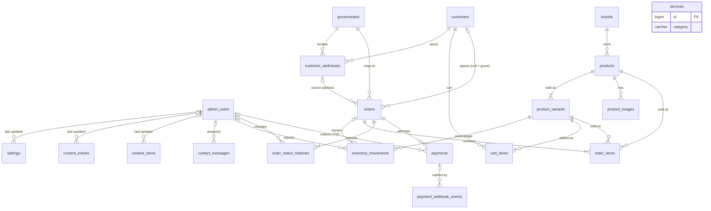

# Octogenix Pharma & Jovie — Database Design v0.3 (approved baseline)

Status: **approved baseline for implementation**. Not production-ready until the launch blockers in §10 are resolved and §11 validation is complete.

Supersedes v0.2. Target: **MySQL 8.0.16 or newer** (CHECK constraints are only enforced from 8.0.16). Development machine verified: MySQL Community Server **8.0.44**. MariaDB is **not** supported by this design.

---

## 1. Confirmed requirements

| # | Decision | Source |
|---|---|---|
| C1 | All money is stored as **integer piastres** (`INT UNSIGNED`, 1 EGP = 100 piastres). Columns end in `_piastres`. | v0.3 approval |
| C2 | **One existing Angular project** with separate route areas: corporate site, Jovie store, admin dashboard. Layout and components stay in Angular. Admins edit approved content through explicit content keys — no page builder. | v0.2 + v0.3 approval |
| C3 | Payment methods: **online card** and **cash on delivery (COD)**. The card provider is **not selected**; the integration is a configurable driver. | v0.3 approval |
| C4 | Shipping fee is configured **per governorate**. The fee, COD fee and full address are **snapshotted on the order**. | v0.3 approval |
| C5 | `products` + `product_variants`; each purchasable variant has its own SKU, price and stock. | v0.3 approval |
| C6 | **Guest checkout and registered checkout** are both supported. `orders.customer_id` is nullable. | v0.3 approval |
| C7 | **No batch or expiry tracking.** Basic stock quantity and an inventory movement ledger are kept. | v0.2 approval |
| C8 | Egypt only; currency EGP; languages Arabic and English. | Project brief |
| C9 | Bilingual storage: paired `_en` / `_ar` columns for entities; key-based rows for page content. | v0.2 proposal, unchanged |
| C10 | Never store card numbers or CVVs. Payment results are verified server-side; webhooks are signature-checked and de-duplicated. | Project brief |

## 2. Change log v0.2 → v0.3

| # | Change | Reason |
|---|---|---|
| 1 | Every `*_cents` column renamed to `*_piastres`; all CHECKs, settings keys and API fields renamed accordingly. API money fields are `{ "amount_piastres": int, "currency": "EGP" }`. | C1 |
| 2 | Auth fixed to **Sanctum SPA (cookie/session) auth** with two session guards, `admin` and `customer`. `personal_access_tokens` is **not created**. | C2 — one Angular app, one origin |
| 3 | `orders.customer_id` → **nullable**. Added `guest_access_token_hash`. `idempotency_key` is now **globally unique** (a composite with a nullable column would not de-duplicate guest orders). | C6 |
| 4 | Order status flow split into **card** and **COD** paths; new status `pending_confirmation` (COD awaiting admin confirmation); `returned` retained for refused/failed deliveries. | C3 |
| 5 | `payments.collected_by_admin_id` restored (COD collection). COD orders get a `payments` row with `provider = 'cod'`. | C3 |
| 6 | `governorates.cod_available` added. Settings `store.cod_enabled`, `store.cod_fee_piastres`, `store.card_payments_enabled`, `store.card_provider` added. | C3, C4 |
| 7 | Soft-delete awareness added to the generated "one default/primary per parent" keys (`product_variants`, `customer_addresses`). | Integrity |
| 8 | `content_entries` / `content_items` `site` values fixed to `corporate`, `jovie`, `admin` is **not** a content site. | C2 |
| 9 | Test requirements per module added (§9). | v0.3 approval |

## 3. Conventions

| Item | Rule |
|---|---|
| Engine / charset | InnoDB, `utf8mb4`, `utf8mb4_unicode_ci` |
| PK | `id BIGINT UNSIGNED AUTO_INCREMENT`; all FKs `BIGINT UNSIGNED` |
| Timestamps | `DATETIME` (not `TIMESTAMP`, which ends in 2038). "ts" = `created_at`, `updated_at` `DATETIME NULL`. "sd" = `deleted_at DATETIME NULL` (indexed). Stored in UTC; displayed in `Africa/Cairo`. |
| Booleans | `TINYINT(1) NOT NULL` with explicit default |
| Status columns | `VARCHAR(n)` backed by PHP enums (no MySQL `ENUM`) |
| Money | `*_piastres INT UNSIGNED` (max ≈ 42.9 M EGP per value) |
| Bilingual | `x_en/ar` = two columns of the same type |
| Files | `*_path VARCHAR(255)`, relative to the storage disk |
| Phone | `VARCHAR(20)`, E.164 (`+201XXXXXXXXX` for Egyptian mobiles) |
| FK actions | RES = RESTRICT, SN = SET NULL, CAS = CASCADE |
| MySQL rule | A CHECK constraint or STORED generated column must not use a column whose FK action is CASCADE or SET NULL. All such rules below respect this. |

## 4. Table inventory

### 4.1 Essential for the initial release (22 + framework)

| Module | Tables |
|---|---|
| Framework | `sessions`, `cache`, `cache_locks`, `jobs`, `job_batches`, `failed_jobs`, `migrations` |
| Admin access | `admin_users`, `admin_password_reset_tokens` |
| Content | `settings`, `content_entries`, `content_items`, `brands`, `services`, `contact_messages` |
| Catalog | `products`, `product_variants`, `product_images`, `inventory_movements` |
| Customers & shipping | `governorates`, `customers`, `customer_password_reset_tokens`, `customer_addresses`, `cart_items` |
| Orders | `orders`, `order_items`, `order_status_histories` |
| Payments | `payments`, `payment_webhook_events` |

### 4.2 Optional (separate migrations, only when approved)

`audit_logs` (recommended before store launch), `refunds` (needed once the refund policy is confirmed), `product_categories` + `add_category_id_to_products`, `faqs`, `product_feeding_guides`, `coupons` + `coupon_redemptions` + `add_coupon_columns_to_orders` + `add_is_discountable_to_products`, `shipments`, `add_two_factor_columns_to_admin_users`, `cities`.

### 4.3 Not required

`pages`, `page_sections`, `banners`, `inventory_batches`, `shipping_zones`, `carts`, `notification_logs`, `personal_access_tokens`, Laravel default `users` / `password_reset_tokens`, spatie permission tables (unless custom roles become a requirement).

---

## 5. Table specifications

### A. Admin access

#### `admin_users` · ts
| Column | Type | NULL | Default | Rules |
|---|---|---|---|---|
| id | BIGINT UNSIGNED | no | AI | PK |
| name | VARCHAR(120) | no | | |
| email | VARCHAR(255) | no | | UNIQUE, lowercase |
| password | VARCHAR(255) | no | | hash |
| role | VARCHAR(30) | no | | `super_admin`, `content_editor`, `store_manager`, `support` (role set pending D-09) |
| is_active | TINYINT(1) | no | 1 | |
| locale | CHAR(2) | no | `'en'` | `en`/`ar` |
| last_login_at | DATETIME | yes | NULL | |
| last_login_ip | VARCHAR(45) | yes | NULL | |
| remember_token | VARCHAR(100) | yes | NULL | |

Never hard-deleted. The last active `super_admin` cannot be deactivated or demoted.

#### `admin_password_reset_tokens`
`email VARCHAR(255)` PK · `token VARCHAR(255)` (hashed) · `created_at DATETIME NULL`. Tokens expire after 60 minutes.

### B. Content

#### `settings` · ts
| Column | Type | NULL | Default | Rules |
|---|---|---|---|---|
| id | BIGINT UNSIGNED | no | AI | PK |
| key | VARCHAR(100) | no | | UNIQUE |
| group | VARCHAR(50) | no | | `contact`, `social`, `notifications`, `store` |
| type | VARCHAR(20) | no | | `string`, `email`, `email_list`, `phone_list`, `url`, `boolean`, `integer`, `money` |
| value | JSON | yes | NULL | validated by `type` |
| is_public | TINYINT(1) | no | 0 | |
| updated_by_admin_id | BIGINT UNSIGNED | yes | NULL | → admin_users SN |

Index `(group)`. Keys are defined in a code registry and seeded; admins edit values only.

Seeded keys (values are **placeholders** until the client confirms them):

| Key | Type | Public | Seeded value |
|---|---|---|---|
| `contact.phones` | phone_list | yes | the three numbers currently in the Angular template (client to confirm) |
| `contact.email` | email | yes | the address currently in the Angular template (client to confirm) |
| `contact.notification_recipients` | email_list | no | empty — **must be set before launch** |
| `orders.notification_recipients` | email_list | no | empty |
| `store.enabled` | boolean | yes | `false` |
| `store.card_payments_enabled` | boolean | yes | `false` (cannot be enabled until a card provider is configured) |
| `store.card_provider` | string | no | `null` |
| `store.cod_enabled` | boolean | yes | `false` (cannot be enabled while `store.cod_fee_piastres` is null) |
| `store.cod_fee_piastres` | money | yes | `null` (0 is a valid explicit value) |
| `store.free_shipping_threshold_piastres` | money | yes | `null` = no free shipping |
| `store.pending_payment_ttl_minutes` | integer | no | `30` (technical default, changeable) |

#### `content_entries` · ts
| Column | Type | NULL | Default | Rules |
|---|---|---|---|---|
| id | BIGINT UNSIGNED | no | AI | PK |
| site | VARCHAR(20) | no | | `corporate`, `jovie` |
| key | VARCHAR(150) | no | | UNIQUE with `site`; matches the Angular translation key (e.g. `hero.kicker`) |
| group | VARCHAR(80) | no | | admin form grouping (e.g. `home.hero`) |
| type | VARCHAR(20) | no | | `text`, `textarea`, `image` |
| value_en / value_ar | TEXT | yes | NULL | plain text only, no HTML |
| image_path | VARCHAR(255) | yes | NULL | NULL = Angular bundled asset |
| image_ar_path | VARCHAR(255) | yes | NULL | optional RTL variant |
| updated_by_admin_id | BIGINT UNSIGNED | yes | NULL | → admin_users SN |

Index `(site, group)`. Required flags, max lengths and image limits come from the registry. Static UI labels stay in Angular only.

#### `content_items` · ts
| Column | Type | NULL | Default | Rules |
|---|---|---|---|---|
| id | BIGINT UNSIGNED | no | AI | PK |
| site | VARCHAR(20) | no | | `corporate`, `jovie` |
| list_key | VARCHAR(80) | no | | e.g. `home.hero_slides`, `values.core`, `values.company`, `about.leadership` |
| title_en/ar | VARCHAR(255) | yes | NULL | |
| subtitle_en/ar | VARCHAR(255) | yes | NULL | |
| description_en/ar | TEXT | yes | NULL | plain text |
| image_path | VARCHAR(255) | yes | NULL | |
| secondary_image_path | VARCHAR(255) | yes | NULL | hover image |
| image_alt_en/ar | VARCHAR(255) | yes | NULL | required when an image is set |
| icon | VARCHAR(20) | yes | NULL | |
| link_url | VARCHAR(500) | yes | NULL | internal path or `https://` |
| sort_order | SMALLINT UNSIGNED | no | 0 | |
| is_active | TINYINT(1) | no | 1 | |
| updated_by_admin_id | BIGINT UNSIGNED | yes | NULL | → admin_users SN |

Index `(site, list_key, is_active, sort_order)`. Lists, their fields and min/max counts are defined in the registry.

#### `brands` · ts sd
| Column | Type | NULL | Default | Rules |
|---|---|---|---|---|
| id | BIGINT UNSIGNED | no | AI | PK |
| slug | VARCHAR(150) | no | | UNIQUE |
| name_en/ar | VARCHAR(150) | no | | |
| label_en/ar | VARCHAR(150) | yes | NULL | |
| short_description_en/ar | VARCHAR(500) | yes | NULL | |
| description_en/ar | TEXT | yes | NULL | |
| logo_path | VARCHAR(255) | yes | NULL | |
| image_path | VARCHAR(255) | yes | NULL | |
| image_alt_en/ar | VARCHAR(255) | yes | NULL | |
| cta_label_en/ar | VARCHAR(80) | yes | NULL | |
| link_type | VARCHAR(20) | no | `'none'` | `none`, `internal`, `external` |
| link_url | VARCHAR(500) | yes | NULL | required unless `none` |
| has_store | TINYINT(1) | no | 0 | |
| is_featured | TINYINT(1) | no | 0 | |
| is_active | TINYINT(1) | no | 0 | |
| sort_order | SMALLINT UNSIGNED | no | 0 | |

Index `(is_active, sort_order)`. Activation requires both names, both short descriptions and an image or logo. Brands with products cannot be hard-deleted.

#### `services` · ts sd
| Column | Type | NULL | Default | Rules |
|---|---|---|---|---|
| id | BIGINT UNSIGNED | no | AI | PK |
| category | VARCHAR(20) | no | | `customers`, `suppliers` |
| title_en/ar | VARCHAR(150) | no | | |
| description_en/ar | TEXT | no | | |
| image_path | VARCHAR(255) | yes | NULL | |
| hover_image_path | VARCHAR(255) | yes | NULL | |
| image_alt_en/ar | VARCHAR(255) | yes | NULL | |
| sort_order | SMALLINT UNSIGNED | no | 0 | |
| is_active | TINYINT(1) | no | 0 | |

Index `(category, is_active, sort_order)`.

#### `contact_messages` · ts sd
| Column | Type | NULL | Default | Rules |
|---|---|---|---|---|
| id | BIGINT UNSIGNED | no | AI | PK |
| site | VARCHAR(20) | no | `'corporate'` | `corporate`, `jovie` |
| first_name | VARCHAR(80) | no | | |
| last_name | VARCHAR(80) | yes | NULL | |
| email | VARCHAR(255) | no | | |
| phone | VARCHAR(20) | yes | NULL | E.164; international allowed |
| subject | VARCHAR(30) | yes | NULL | `general`, `partnership`, `distribution`, `import-export`, `other` (exact values of the Angular form's `<select>`) |
| message | TEXT | no | | 2–5000 chars (the Angular form only requires a value) |
| locale | CHAR(2) | no | | |
| status | VARCHAR(20) | no | `'new'` | `new`, `read`, `in_progress`, `resolved`, `spam`, `archived` |
| assigned_admin_id | BIGINT UNSIGNED | yes | NULL | → admin_users SN |
| admin_notes | TEXT | yes | NULL | |
| read_at / resolved_at | DATETIME | yes | NULL | |
| email_notification_status | VARCHAR(20) | no | `'pending'` | `pending`, `sent`, `failed` |
| email_notification_attempts | TINYINT UNSIGNED | no | 0 | |
| email_notified_at | DATETIME | yes | NULL | |
| email_last_error | VARCHAR(500) | yes | NULL | |
| ip_address | VARCHAR(45) | yes | NULL | |
| user_agent | VARCHAR(255) | yes | NULL | |

Indexes `(status, created_at)`, `(email)`, `(email_notification_status)`.

### C. Catalog & inventory

#### `products` · ts sd
| Column | Type | NULL | Default | Rules |
|---|---|---|---|---|
| id | BIGINT UNSIGNED | no | AI | PK |
| brand_id | BIGINT UNSIGNED | no | | → brands RES |
| slug | VARCHAR(160) | no | | UNIQUE |
| name_en/ar | VARCHAR(200) | no | | |
| subtitle_en/ar | VARCHAR(255) | yes | NULL | |
| short_description_en/ar | VARCHAR(500) | yes | NULL | |
| description_en/ar | TEXT | yes | NULL | plain text |
| ingredients_en/ar | TEXT | yes | NULL | official label only |
| preparation_instructions_en/ar | TEXT | yes | NULL | |
| storage_instructions_en/ar | TEXT | yes | NULL | |
| important_notice_en/ar | TEXT | yes | NULL | |
| nutrition_facts | JSON | yes | NULL | `[{label_en,label_ar,unit,per_100g,per_100ml}]` |
| stage | TINYINT UNSIGNED | yes | NULL | |
| age_from_months / age_to_months | TINYINT UNSIGNED | yes | NULL | CHECK `age_from_months IS NULL OR age_to_months IS NULL OR age_to_months >= age_from_months` |
| registration_number | VARCHAR(100) | yes | NULL | |
| is_active | TINYINT(1) | no | 0 | visible |
| is_purchasable | TINYINT(1) | no | 0 | sellable |
| is_featured | TINYINT(1) | no | 0 | |
| sort_order | SMALLINT UNSIGNED | no | 0 | |
| meta_title_en/ar | VARCHAR(255) | yes | NULL | |
| meta_description_en/ar | VARCHAR(500) | yes | NULL | |

Indexes `(brand_id, is_active, sort_order)`, `(is_active, is_featured)`.

#### `product_variants` · ts sd
| Column | Type | NULL | Default | Rules |
|---|---|---|---|---|
| id | BIGINT UNSIGNED | no | AI | PK |
| product_id | BIGINT UNSIGNED | no | | → products RES |
| sku | VARCHAR(64) | no | | UNIQUE |
| barcode | VARCHAR(32) | yes | NULL | UNIQUE |
| name_en/ar | VARCHAR(100) | no | | e.g. size/pack |
| net_weight_grams | INT UNSIGNED | yes | NULL | |
| price_piastres | INT UNSIGNED | yes | NULL | NULL until the client sets prices. CHECK `price_piastres IS NULL OR price_piastres > 0` |
| compare_at_price_piastres | INT UNSIGNED | yes | NULL | CHECK `compare_at_price_piastres IS NULL OR (price_piastres IS NOT NULL AND compare_at_price_piastres > price_piastres)` |
| stock_quantity | INT | no | 0 | CHECK `stock_quantity >= 0` |
| low_stock_threshold | INT UNSIGNED | yes | NULL | |
| max_per_order | SMALLINT UNSIGNED | yes | NULL | |
| is_default | TINYINT(1) | no | 0 | |
| default_product_key | BIGINT UNSIGNED | yes | STORED `IF(is_default = 1 AND deleted_at IS NULL, product_id, NULL)` | UNIQUE |
| is_active | TINYINT(1) | no | 1 | |
| sort_order | SMALLINT UNSIGNED | no | 0 | |

Index `(product_id, is_active, sort_order)`. A variant is **purchasable** only when: product active + purchasable, brand active + `has_store`, variant active, `price_piastres` not null, stock > 0.

#### `product_images` · ts
| Column | Type | NULL | Default | Rules |
|---|---|---|---|---|
| id | BIGINT UNSIGNED | no | AI | PK |
| product_id | BIGINT UNSIGNED | no | | → products RES |
| path | VARCHAR(255) | no | | jpg/png/webp, size-limited |
| alt_en/ar | VARCHAR(255) | yes | NULL | |
| is_primary | TINYINT(1) | no | 0 | |
| primary_product_key | BIGINT UNSIGNED | yes | STORED `IF(is_primary = 1, product_id, NULL)` | UNIQUE |
| sort_order | SMALLINT UNSIGNED | no | 0 | |

Index `(product_id, sort_order)`.

#### `inventory_movements` (append-only)
| Column | Type | NULL | Default | Rules |
|---|---|---|---|---|
| id | BIGINT UNSIGNED | no | AI | PK |
| product_variant_id | BIGINT UNSIGNED | no | | → product_variants RES |
| quantity_change | INT | no | | CHECK `<> 0` |
| stock_after | INT | no | | CHECK `>= 0` |
| reason | VARCHAR(30) | no | | `initial_stock`, `restock`, `manual_adjustment`, `stock_count_correction`, `write_off`, `order_reserved`, `order_released`, `return_restock` |
| order_id | BIGINT UNSIGNED | yes | NULL | → orders RES (**FK added by migration #21**) |
| admin_user_id | BIGINT UNSIGNED | yes | NULL | → admin_users SN |
| note | VARCHAR(500) | yes | NULL | |
| created_at | DATETIME | no | | |

Indexes `(product_variant_id, created_at)`, `(order_id)`. Service-level rules: `order_*`/`return_restock` require `order_id`; manual reasons require `admin_user_id` and `note`.

### D. Customers & shipping

#### `governorates` · ts
| Column | Type | NULL | Default | Rules |
|---|---|---|---|---|
| id | BIGINT UNSIGNED | no | AI | PK |
| code | VARCHAR(10) | no | | UNIQUE (ISO 3166-2:EG) |
| name_en/ar | VARCHAR(100) | no | | |
| shipping_fee_piastres | INT UNSIGNED | yes | NULL | entered by admin; **no value assumed** |
| delivery_days_min / delivery_days_max | TINYINT UNSIGNED | yes | NULL | CHECK `delivery_days_min IS NULL OR delivery_days_max IS NULL OR delivery_days_min <= delivery_days_max` |
| cod_available | TINYINT(1) | no | 1 | effective only when `store.cod_enabled` |
| is_deliverable | TINYINT(1) | no | 0 | CHECK `is_deliverable = 0 OR shipping_fee_piastres IS NOT NULL` |
| sort_order | SMALLINT UNSIGNED | no | 0 | |

Seeded with the 27 governorates (names and ISO codes only).

#### `customers` · ts sd
| Column | Type | NULL | Default | Rules |
|---|---|---|---|---|
| id | BIGINT UNSIGNED | no | AI | PK |
| first_name / last_name | VARCHAR(80) | no | | |
| email | VARCHAR(255) | no | | UNIQUE; login identifier |
| phone | VARCHAR(20) | no | | Egyptian mobile; not unique |
| password | VARCHAR(255) | no | | hash |
| email_verified_at | DATETIME | yes | NULL | |
| locale | CHAR(2) | no | `'en'` | |
| is_active | TINYINT(1) | no | 1 | |
| last_login_at | DATETIME | yes | NULL | |
| remember_token | VARCHAR(100) | yes | NULL | |
| anonymized_at | DATETIME | yes | NULL | |

#### `customer_password_reset_tokens`
Same structure as `admin_password_reset_tokens`.

#### `customer_addresses` · ts sd
| Column | Type | NULL | Default | Rules |
|---|---|---|---|---|
| id | BIGINT UNSIGNED | no | AI | PK |
| customer_id | BIGINT UNSIGNED | no | | → customers RES |
| label | VARCHAR(50) | yes | NULL | |
| recipient_name | VARCHAR(160) | no | | |
| phone | VARCHAR(20) | no | | |
| governorate_id | BIGINT UNSIGNED | no | | → governorates RES |
| city | VARCHAR(100) | no | | |
| area | VARCHAR(100) | yes | NULL | |
| street | VARCHAR(255) | no | | |
| building / floor / apartment | VARCHAR(50/20/20) | yes | NULL | |
| landmark | VARCHAR(255) | yes | NULL | |
| postal_code | VARCHAR(10) | yes | NULL | |
| is_default | TINYINT(1) | no | 0 | |
| default_customer_key | BIGINT UNSIGNED | yes | STORED `IF(is_default = 1 AND deleted_at IS NULL, customer_id, NULL)` | UNIQUE |

Index `(customer_id)`.

#### `cart_items` (registered customers only) · ts
| Column | Type | NULL | Default | Rules |
|---|---|---|---|---|
| id | BIGINT UNSIGNED | no | AI | PK |
| customer_id | BIGINT UNSIGNED | no | | → customers CAS |
| product_variant_id | BIGINT UNSIGNED | no | | → product_variants CAS |
| quantity | SMALLINT UNSIGNED | no | | CHECK `quantity > 0` |

UNIQUE `(customer_id, product_variant_id)`. **Guest carts live in browser storage**; at checkout the guest sends variant IDs and quantities; on login the browser cart is merged (capped by stock and `max_per_order`).

### F. Orders

#### `orders` (never deleted) · ts
| Column | Type | NULL | Default | Rules |
|---|---|---|---|---|
| id | BIGINT UNSIGNED | no | AI | PK |
| order_number | VARCHAR(20) | no | | UNIQUE (format D-15) |
| customer_id | BIGINT UNSIGNED | **yes** | NULL | → customers RES; **NULL = guest order** |
| status | VARCHAR(30) | no | | §7.2 |
| payment_status | VARCHAR(30) | no | `'unpaid'` | `unpaid`, `paid` (`partially_refunded`, `refunded` only once `refunds` exists) |
| payment_method | VARCHAR(20) | no | | `card`, `cod` |
| currency | CHAR(3) | no | `'EGP'` | |
| subtotal_piastres | INT UNSIGNED | no | | Σ line totals |
| discount_piastres | INT UNSIGNED | no | 0 | 0 unless coupons are adopted. CHECK `discount_piastres <= subtotal_piastres` |
| shipping_fee_piastres | INT UNSIGNED | no | | snapshot of the governorate fee (after free-shipping rule) |
| cod_fee_piastres | INT UNSIGNED | no | 0 | snapshot; must be 0 when `payment_method = 'card'` (CHECK) |
| total_piastres | INT UNSIGNED | no | | CHECK `total_piastres = subtotal_piastres - discount_piastres + shipping_fee_piastres + cod_fee_piastres` |
| customer_first_name / customer_last_name | VARCHAR(80) | no | | snapshot (guest or customer) |
| customer_email | VARCHAR(255) | no | | snapshot; required for guests (confirmation + access link) |
| customer_phone | VARCHAR(20) | no | | snapshot |
| customer_address_id | BIGINT UNSIGNED | yes | NULL | → customer_addresses SN; always NULL for guests |
| shipping_recipient_name | VARCHAR(160) | no | | snapshot |
| shipping_phone | VARCHAR(20) | no | | snapshot |
| shipping_governorate_id | BIGINT UNSIGNED | no | | → governorates RES |
| shipping_governorate_name_en/ar | VARCHAR(100) | no | | snapshot |
| shipping_city | VARCHAR(100) | no | | snapshot |
| shipping_area | VARCHAR(100) | yes | NULL | snapshot |
| shipping_street | VARCHAR(255) | no | | snapshot |
| shipping_building / shipping_floor / shipping_apartment | VARCHAR(50/20/20) | yes | NULL | snapshot |
| shipping_landmark | VARCHAR(255) | yes | NULL | snapshot |
| shipping_postal_code | VARCHAR(10) | yes | NULL | snapshot |
| customer_note | VARCHAR(1000) | yes | NULL | |
| admin_note | TEXT | yes | NULL | |
| locale | CHAR(2) | no | | |
| idempotency_key | CHAR(36) | no | | **UNIQUE** (UUID from the client per checkout attempt) |
| guest_access_token_hash | CHAR(64) | yes | NULL | UNIQUE; SHA-256 of the random token in the guest's order link. Rule "guest orders must have a token" is enforced in the checkout service (kept out of a CHECK because `customer_id` is an FK column) |
| payment_expires_at | DATETIME | yes | NULL | card orders only |
| placed_at | DATETIME | no | | |
| confirmed_at / paid_at / shipped_at / delivered_at / cancelled_at / returned_at | DATETIME | yes | NULL | |
| cancelled_by | VARCHAR(20) | yes | NULL | `customer`, `admin`, `system` |
| cancellation_reason | VARCHAR(500) | yes | NULL | |
| ip_address | VARCHAR(45) | yes | NULL | |
| user_agent | VARCHAR(255) | yes | NULL | |

Additional CHECK: `payment_method = 'cod' OR cod_fee_piastres = 0`.
Indexes `(customer_id, placed_at)`, `(status, placed_at)`, `(payment_status)`, `(status, payment_expires_at)`, `(customer_email)`, `(customer_phone)`, `(shipping_governorate_id)`.

#### `order_items` · ts
| Column | Type | NULL | Default | Rules |
|---|---|---|---|---|
| id | BIGINT UNSIGNED | no | AI | PK |
| order_id | BIGINT UNSIGNED | no | | → orders RES |
| product_id | BIGINT UNSIGNED | no | | → products RES |
| product_variant_id | BIGINT UNSIGNED | no | | → product_variants RES |
| sku | VARCHAR(64) | no | | snapshot |
| product_name_en/ar | VARCHAR(200) | no | | snapshot |
| variant_name_en/ar | VARCHAR(100) | no | | snapshot |
| image_path | VARCHAR(255) | yes | NULL | snapshot |
| unit_price_piastres | INT UNSIGNED | no | | snapshot from the server |
| compare_at_price_piastres | INT UNSIGNED | yes | NULL | snapshot |
| quantity | SMALLINT UNSIGNED | no | | CHECK `> 0` |
| discount_piastres | INT UNSIGNED | no | 0 | |
| line_total_piastres | INT UNSIGNED | no | | CHECK `line_total_piastres = unit_price_piastres * quantity - discount_piastres` |

UNIQUE `(order_id, product_variant_id)`; index `(product_variant_id)`.

#### `order_status_histories` (append-only)
| Column | Type | NULL | Default | Rules |
|---|---|---|---|---|
| id | BIGINT UNSIGNED | no | AI | PK |
| order_id | BIGINT UNSIGNED | no | | → orders RES |
| field | VARCHAR(20) | no | | `status`, `payment_status` |
| from_value | VARCHAR(30) | yes | NULL | |
| to_value | VARCHAR(30) | no | | |
| actor_type | VARCHAR(20) | no | | `customer`, `guest`, `admin`, `system`, `payment_gateway` |
| admin_user_id | BIGINT UNSIGNED | yes | NULL | → admin_users SN |
| note | VARCHAR(1000) | yes | NULL | |
| is_customer_visible | TINYINT(1) | no | 1 | |
| created_at | DATETIME | no | | |

Index `(order_id, created_at)`.

### G. Payments

#### `payments` · ts
| Column | Type | NULL | Default | Rules |
|---|---|---|---|---|
| id | BIGINT UNSIGNED | no | AI | PK |
| order_id | BIGINT UNSIGNED | no | | → orders RES |
| merchant_reference | VARCHAR(64) | no | | UNIQUE; our reference sent to the gateway |
| provider | VARCHAR(30) | no | | `cod`, or the configured card driver name |
| method | VARCHAR(20) | no | | `card`, `cod` |
| status | VARCHAR(20) | no | `'initiated'` | `initiated`, `pending`, `succeeded`, `failed`, `cancelled`, `expired` |
| amount_piastres | INT UNSIGNED | no | | equals the order total at creation |
| currency | CHAR(3) | no | `'EGP'` | |
| provider_order_id | VARCHAR(100) | yes | NULL | |
| provider_transaction_id | VARCHAR(100) | yes | NULL | UNIQUE with `provider` |
| provider_reference | VARCHAR(100) | yes | NULL | |
| card_brand | VARCHAR(20) | yes | NULL | never PAN / expiry / CVV |
| card_last4 | CHAR(4) | yes | NULL | |
| failure_code | VARCHAR(100) | yes | NULL | |
| failure_message | VARCHAR(500) | yes | NULL | |
| is_test | TINYINT(1) | no | 0 | |
| gateway_response | JSON | yes | NULL | sanitized |
| expires_at | DATETIME | yes | NULL | |
| verified_at | DATETIME | yes | NULL | set only after server-side verification (card) or admin collection (COD) |
| paid_at | DATETIME | yes | NULL | |
| collected_by_admin_id | BIGINT UNSIGNED | yes | NULL | → admin_users SN; COD only |

Indexes `(order_id, status)`, `(provider, provider_order_id)`. At most one `succeeded` payment per order (enforced under an order row lock).

#### `payment_webhook_events`
| Column | Type | NULL | Default | Rules |
|---|---|---|---|---|
| id | BIGINT UNSIGNED | no | AI | PK |
| provider | VARCHAR(30) | no | | |
| event_key | VARCHAR(191) | no | | UNIQUE with `provider` |
| event_type | VARCHAR(100) | yes | NULL | |
| payment_id | BIGINT UNSIGNED | yes | NULL | → payments SN |
| signature_valid | TINYINT(1) | no | | |
| payload | JSON | no | | |
| processing_status | VARCHAR(20) | no | `'received'` | `received`, `processed`, `ignored`, `failed` |
| processing_error | VARCHAR(1000) | yes | NULL | |
| attempts | TINYINT UNSIGNED | no | 0 | |
| received_at | DATETIME | no | | |
| processed_at | DATETIME | yes | NULL | |

Index `(processing_status, received_at)`.

### H. Optional tables (unchanged from v0.2 except money renamed)

- `audit_logs`: id, admin_user_id (SN), action, auditable_type, auditable_id, old_values JSON, new_values JSON, ip_address, user_agent, created_at.
- `refunds`: id, order_id (RES), payment_id (RES), amount_piastres (CHECK > 0), status, reason, provider_refund_id, requested_by_admin_id (RES), failure_message, processed_at, ts.
- `product_categories` (+ `add_category_id_to_products`, SN), `faqs` (site-scoped), `product_feeding_guides` (product CAS).
- `coupons` (percent_off, amount_off_piastres, min_subtotal_piastres, max_discount_piastres, …), `coupon_redemptions` (`customer_id` **nullable**, FK RES, so guest orders can redeem), `add_coupon_columns_to_orders`, `add_is_discountable_to_products`.
- `shipments` (courier_cost_piastres, cod_collected_piastres, …).
- `add_two_factor_columns_to_admin_users`.

---

## 6. Relationships & ERD



No circular dependencies; no self-references; no back-references (`customers.default_address_id`, `orders.latest_payment_id`, `products.primary_image_id` are intentionally absent).

## 7. Business rules

### 7.1 Inventory
- Stock changes only through the inventory service, in one transaction with an `inventory_movements` row.
- Order placement reserves stock with `UPDATE product_variants SET stock_quantity = stock_quantity - :q WHERE id = :id AND stock_quantity >= :q AND is_active = 1`, variants locked in ascending ID order; 0 affected rows → rollback + "out of stock".
- Cancel / expire → `order_released`. Returned goods → `return_restock` only on admin confirmation. Damage → `write_off`.

### 7.2 Order status flows

Card:
```
pending_payment ──payment verified──► confirmed ──► processing ──► shipped ──► delivered
pending_payment ──TTL passed──► expired                [stock released, system]
pending_payment ──customer/admin──► cancelled           [stock released]
shipped ──refused/failed──► returned
```
COD:
```
pending_confirmation ──admin──► confirmed ──► processing ──► shipped ──► delivered
pending_confirmation / confirmed / processing ──► cancelled   [stock released]
shipped ──refused/failed──► returned
delivered: admin marks cash collected → payment succeeded, order payment_status = paid
```
- Cancelling a **paid card order** is blocked by the API until the refund policy (D-05) and `refunds` are implemented.
- Every change writes `order_status_histories`; any other transition is rejected.

### 7.3 Checkout (registered and guest)
- Client sends: variant IDs + quantities, address (saved address ID for customers; full address for guests), contact details (guests), payment method, idempotency key. **Never prices or totals.**
- Server validates purchasability, stock, `max_per_order`, governorate deliverability, method availability (`store.card_payments_enabled`, `store.cod_enabled` + `governorates.cod_available`), computes subtotal, shipping (free-shipping threshold if set), COD fee and total, and snapshots everything.
- Price change since the client's view → `409` with new totals.
- Guest orders: a random 40+ byte token is generated, its SHA-256 stored in `guest_access_token_hash`, and the plain token sent only in the confirmation email link. Guest order lookup by order number + email **re-sends** the link; it never displays the order directly.
- Guest checkout and order lookup are rate-limited per IP and per email.
- Guest orders are **not** automatically linked to accounts registered later (D-12).

### 7.4 Payments
- Card: hosted page/iframe of the configured provider; only brand + last 4 stored. Webhook: store event (duplicate `(provider, event_key)` → 200, stop) → verify signature → queued job locks order + payment, checks amount and currency, re-verifies with the provider where supported, applies an allowed transition. The browser redirect is never trusted.
- Late success after expiry/cancellation → flagged for admin action.
- COD: payment row created at placement (`status = pending`); admin marks it collected after delivery.
- Until a provider is chosen, a `fake` driver exists **for automated tests only**; `store.card_payments_enabled` cannot be turned on without a real configured driver.

### 7.5 Contact messages
Save first (201) → queued email after commit → status recorded; failures never affect the stored message; dashboard resend.

### 7.6 Authorization
- Sanctum SPA cookie auth; session guards `admin` (admin_users) and `customer` (customers). Routes use `auth:admin` / `auth:customer` explicitly — never a combined guard.
- Admin endpoints: Policies per role. Hiding UI is never the control.
- Session ID regenerated at login; CSRF protection via Sanctum's `XSRF-TOKEN` cookie.

## 8. Migration order and rollback

| # | Migration | FKs to | Phase |
|---|---|---|---|
| 0a | `0001_01_01_000000_create_sessions_table` (edited default; no `users`) | — | 0 |
| 0b | `0001_01_01_000001_create_cache_table` | — | 0 |
| 0c | `0001_01_01_000002_create_jobs_table` | — | 0 |
| 1 | `create_admin_users_table` | — | 1 |
| 2 | `create_admin_password_reset_tokens_table` | — | 1 |
| 3 | `create_settings_table` | admin_users | 2 |
| 4 | `create_contact_messages_table` | admin_users | 2 |
| 5 | `create_content_entries_table` | admin_users | 3 |
| 6 | `create_content_items_table` | admin_users | 3 |
| 7 | `create_brands_table` | — | 3 |
| 8 | `create_services_table` | — | 3 |
| 9 | `create_products_table` | brands | 4 |
| 10 | `create_product_variants_table` | products | 4 |
| 11 | `create_product_images_table` | products | 4 |
| 12 | `create_inventory_movements_table` (order_id column, **no FK yet**) | product_variants, admin_users | 4 |
| 13 | `create_governorates_table` | — | 5 |
| 14 | `create_customers_table` | — | 5 |
| 15 | `create_customer_password_reset_tokens_table` | — | 5 |
| 16 | `create_customer_addresses_table` | customers, governorates | 5 |
| 17 | `create_cart_items_table` | customers, product_variants | 5 |
| 18 | `create_orders_table` | customers, customer_addresses, governorates | 6 |
| 19 | `create_order_items_table` | orders, products, product_variants | 6 |
| 20 | `create_order_status_histories_table` | orders, admin_users | 6 |
| 21 | `add_order_foreign_key_to_inventory_movements_table` | orders | 6 |
| 22 | `create_payments_table` | orders, admin_users | 7 |
| 23 | `create_payment_webhook_events_table` | payments | 7 |

Rollback: Laravel reverses migrations (LIFO), so dependents are always dropped first. #21 `down()` drops only the FK. `add_*` migrations drop FK then column. `create_*` use `dropIfExists`. CHECK constraints are added with `ALTER TABLE … ADD CONSTRAINT` in the same migration as their table and disappear with it. **Production is never rolled back; fixes are forward migrations.** Every phase's test suite runs `migrate:fresh` and a full `migrate:rollback` on MySQL.

## 9. Test requirements

| Area | Required tests |
|---|---|
| Migrations | `migrate:fresh` + full rollback + re-migrate on MySQL 8; each CHECK rejects an invalid row; each generated unique key rejects a second default/primary |
| Auth | admin and customer guards isolated (a customer session cannot reach `/admin` routes and vice versa); inactive accounts rejected; login rate limit; CSRF required |
| Authorization | each admin endpoint denies roles without permission (403) |
| Contact | valid submission stored even when the mailer throws; validation errors; rate limit; honeypot |
| Content | public endpoints return both languages; registry rejects unknown keys; plain-text enforcement |
| Catalog | inactive/unpriced/out-of-stock variants not purchasable |
| Inventory | concurrent reservations never oversell (parallel requests against MySQL); every stock change writes a movement |
| Checkout | server-calculated totals ignore client prices; shipping fee from governorate; COD fee only for COD; idempotent double submit; guest and registered paths; non-deliverable governorate rejected |
| Orders | only allowed transitions; history rows written; stock released on cancel/expire; paid card order cannot be cancelled |
| Payments | invalid signature ignored; duplicate webhook processed once; amount mismatch rejected; late payment flagged; COD collection |
| Privacy | guest order access requires a valid token; lookup never leaks order data; card fields absent from storage |

## 10. Open decisions

### Launch blockers (feature can be built; production launch of that feature waits)
| # | Decision | Blocks |
|---|---|---|
| D-01 | **Card payment provider**, merchant account, credentials, webhook signature spec | Card payments go-live. COD and everything else can proceed. |
| D-02 | **Shipping fee and delivery days per governorate**, which governorates are served | Store launch (admin enters values; no code change) |
| D-03 | **Product data**: sizes/packs, SKUs, prices, opening stock, images, official label content | Store launch |
| D-04 | **VAT treatment and ETA e-receipt obligation** | Store launch; may add tax columns |
| D-05 | **Cancellation, refund and return policy** | Cancelling paid card orders, `refunds`, returns handling |
| D-06 | **COD fee** (0 is valid) and COD availability per governorate | Enabling COD (`store.cod_fee_piastres` must be set) |
| D-07 | **Production hosting & domains**: API on the same origin (reverse proxy) or a sibling subdomain; MySQL ≥ 8.0.16 | Deployment |
| D-08 | **Email provider and sender domain** (SPF/DKIM), notification recipients | Production email (dev uses the log mailer) |
| D-13 | **Legal pages**: privacy policy, terms, data retention periods (PDPL) | Store launch |

### Can be configured or decided later
| # | Decision | Default until decided |
|---|---|---|
| D-09 | Admin role set | `super_admin` only; proposed roles in code |
| D-10 | Customer login identifier / verification | Email + password; email verification before account order history |
| D-11 | Discounts/coupons and infant-formula promotion rules | Not built |
| D-12 | Linking guest orders to accounts | Not linked |
| D-14 | Admin 2FA | Not built (recommended) |
| D-15 | Order number format | `JV-YYMMDD-NNNNN` proposal |
| D-16 | FAQs, feeding guides, categories on the Jovie store | Not built until the Jovie UI defines them |
| D-17 | `audit_logs` adoption | Recommended before store launch |
| D-18 | Free-shipping threshold | Disabled (`null`) |
| D-19 | Jovie route prefix inside the Angular app | **Confirmed:** store at `/jovie/...`, dashboard at `/admin/...` |

## 11. Validation still required before production
1. Run every migration, rollback and CHECK test on MySQL 8 (local 8.0.44 available; production version per D-07).
2. Concurrency tests for stock reservation and webhook duplication on MySQL.
3. `EXPLAIN` the main listing and dashboard queries with realistic data volumes.
4. Client legal/accounting confirmation of D-04, D-05, D-13.
5. Security review of auth, payment and guest-access flows before go-live.
